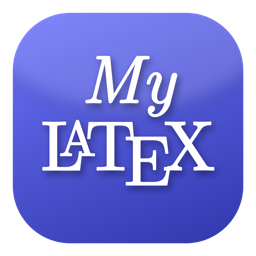
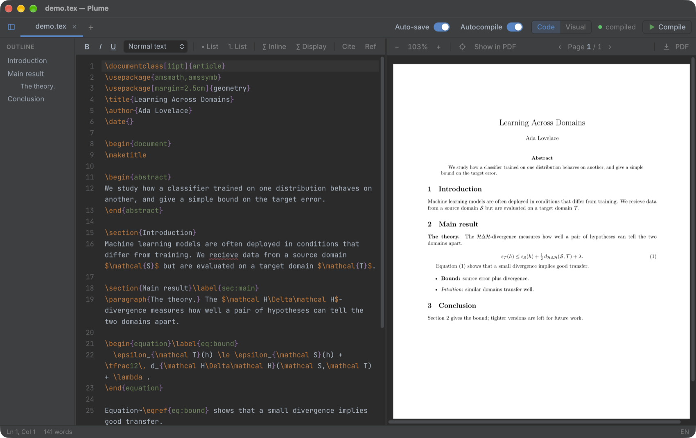
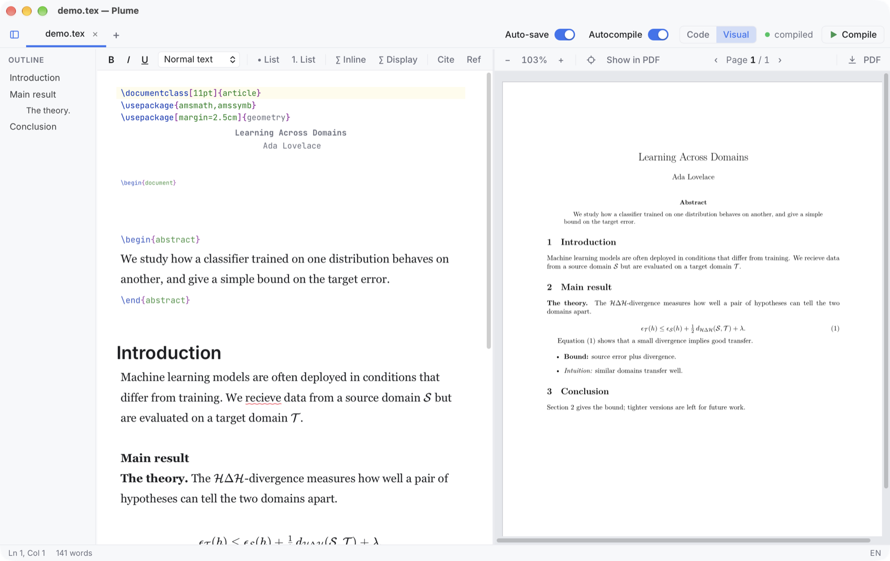
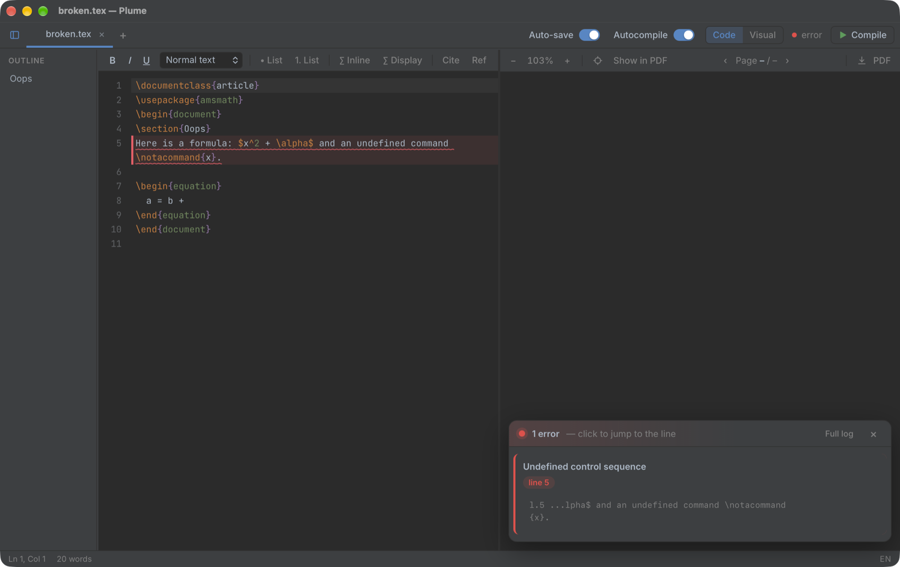

<p align="center"></p>
<h1 align="center">MyLatex</h1>
<p align="center"><b>Un éditeur LaTeX rapide, léger et natif pour macOS.</b><br>
Aperçu PDF en direct · mode Visuel · SyncTeX · compilation hors-ligne · correcteur orthographique</p>
<p align="center">
  <a href="../../releases/latest"><b>⬇ Télécharger pour macOS</b></a> ·
  <a href="README.md">English</a> ·
  <a href="CONTRIBUTING.md">Contribuer</a>
</p>



MyLatex est une petite application (Tauri + Rust, ~55 Mo, ~150–300 Mo de RAM) qui compile le LaTeX avec le moteur [Tectonic](https://tectonic-typesetting.github.io) intégré. **Pas besoin d'installer TeX Live (4 Go+), ni de compte** : tout fonctionne hors-ligne, et la 1re compilation est rapide car les paquets courants sont déjà dans l'app.

## Télécharger et installer

1. Ouvrez la [**dernière version**](../../releases/latest) et téléchargez `MyLatex.dmg` (Mac Apple Silicon).
2. Ouvrez-le et glissez **MyLatex** dans **Applications**.
3. L'app n'est pas encore notarisée par Apple : la **première fois**, faites **clic droit → Ouvrir** (ou *Réglages Système → Confidentialité et sécurité → Ouvrir quand même*). Ensuite elle s'ouvre normalement.

## Fonctionnalités

- ⚡ **Compilation rapide** : Tectonic hors-ligne d'abord, barre de progression (fichiers, taille téléchargée), paquets manquants détectés et téléchargés à la demande
- 🔗 **SyncTeX dans les deux sens** : « Voir dans le PDF » depuis le code, double-clic dans le PDF pour revenir au mot exact
- 👁 **Mode Visuel** à la Overleaf : titres, gras/italique, listes et maths KaTeX rendus dans l'éditeur
- ✍️ **Édition assistée** : autocomplétion (commandes, `\begin`, `\cite` depuis le `.bib`, `\ref` depuis les `\label`), snippets (`;eq`), fermeture auto de `{}` `$` `\begin…\end`, déplacer/dupliquer une ligne
- 🔤 **Orthographe** français et anglais (auto ou manuel), soulignement rouge, suggestions, dictionnaire perso
- 🧯 **Erreurs lisibles** : cartes cliquables, soulignement dans le code, compteur de warnings
- 📑 **Projets** : onglets, plan du document, multi-fichiers, glisser-déposer d'images, sauvegarde auto, restauration de session
- 📄 **Modèles** : article, ICML, NeurIPS, IEEE, beamer, CV, lettre
- 🎨 **Thèmes** façon JetBrains · interface en 4 langues (EN/FR/ES/DE) · menu macOS natif

<p align="center">


</p>

## Compiler depuis les sources

```bash
git clone https://github.com/1p0tato1/MyLatex.git mylatex && cd mylatex/app
npm ci && npm run build
tools/fetch-tectonic.sh && tools/make-seed.sh
cd src-tauri && cargo run          # développement
cd .. && tools/release.sh          # → ../dist/MyLatex.app et MyLatex.dmg
```

## Limites connues
- Build Apple Silicon uniquement (Intel : compiler depuis les sources). Pas encore notarisée.
- Les modèles ICML/NeurIPS/IEEE sont des imitations : placez les `.sty` officiels à côté de votre fichier pour les vrais.

## Licence
[MIT](LICENSE) — composants tiers : [THIRD_PARTY.md](THIRD_PARTY.md).
