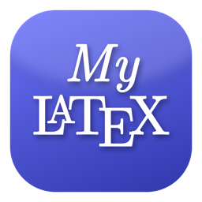
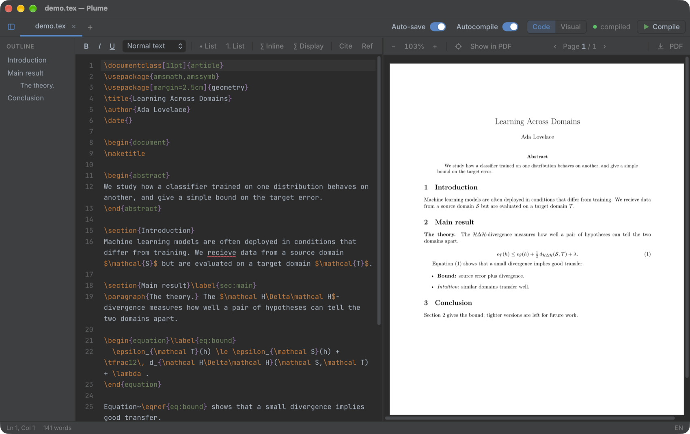
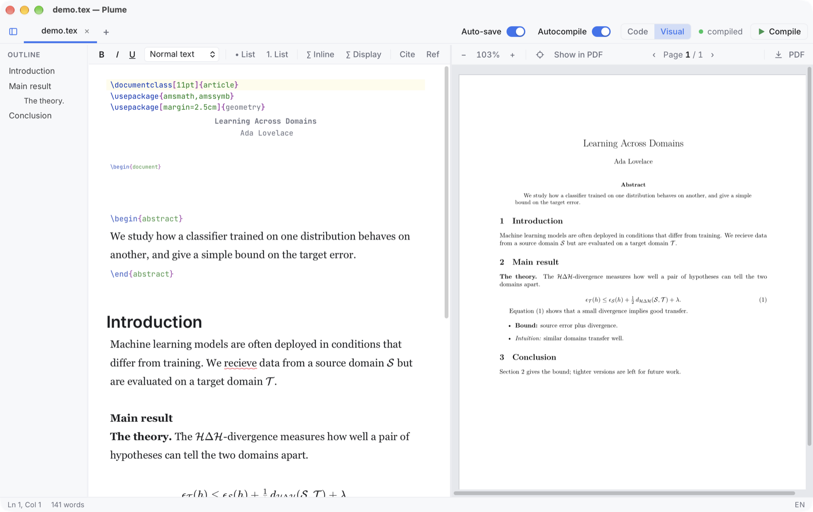
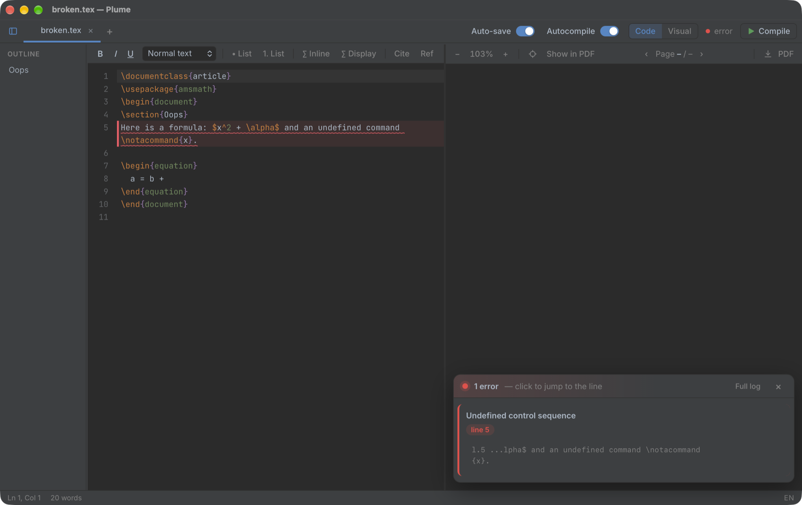
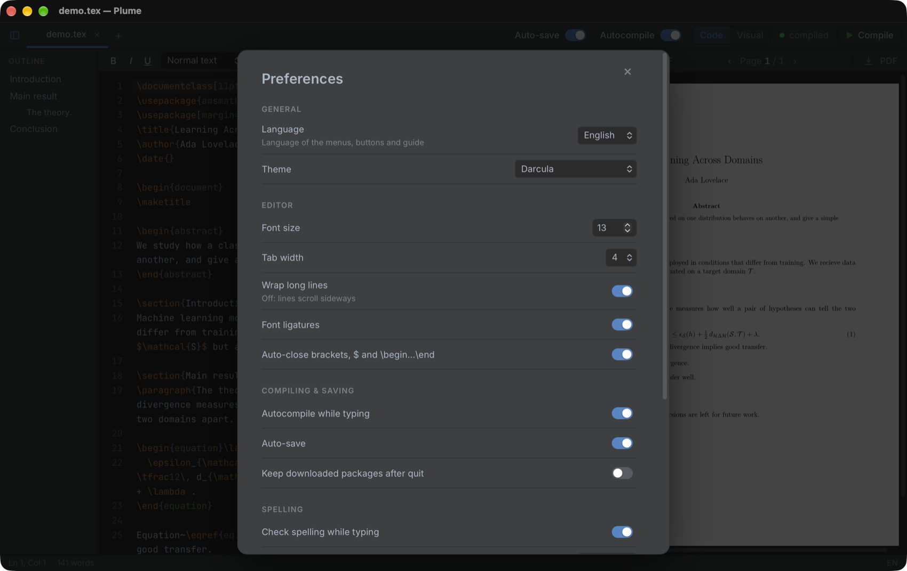

<p align="center"></p>
<h1 align="center">MyLatex</h1>
<p align="center"><b>A fast, light, native LaTeX editor for macOS.</b><br>
Live PDF preview · Visual mode · SyncTeX · offline compiling · spell check · English / Français / Español / Deutsch</p>
<p align="center">
  <a href="../../releases/latest"><b>⬇ Download for macOS</b></a> ·
  <a href="README.fr.md">Français</a> ·
  <a href="CONTRIBUTING.md">Contributing</a>
</p>



MyLatex is a small desktop app (Tauri + Rust, ~55 MB, ~150–300 MB RAM) that compiles LaTeX with the embedded [Tectonic](https://tectonic-typesetting.github.io) engine. **No TeX Live install (4 GB+) and no account needed** — it works offline, and the first compile is fast because the common packages are already inside the app.

## Download & install

1. Go to the [**latest release**](../../releases/latest) and download `MyLatex.dmg` (Apple Silicon Macs).
2. Open it and drag **MyLatex** into **Applications**.
3. The app is not yet notarized by Apple, so the **first time** use **right-click → Open** (or *System Settings → Privacy & Security → Open Anyway*). After that it opens normally.

## Features

| | |
|---|---|
| ⚡ **Fast compiling** | Offline-first Tectonic, progress bar with file count and download size, missing packages are detected and downloaded on request |
| 🔗 **SyncTeX both ways** | “Show in PDF” from the code, double-click the PDF to jump back to the exact word |
| 👁 **Visual mode** | Overleaf-style rendering of headings, bold/italic, lists and KaTeX math right in the editor |
| ✍️ **Smart editing** | Autocomplete for commands, `\begin`, `\cite` (from your `.bib`) and `\ref` (from your `\label`s); snippets (`;eq`), auto-close `{}` `$` `\begin…\end`, move/duplicate lines |
| 🔤 **Spell check** | English and French (auto-detected or manual), red wavy underline, suggestions, personal dictionary — tiny memory footprint |
| 🧯 **Readable errors** | Error cards with line jump, red underlines in the code, warning counter |
| 📑 **Projects** | Tabs, outline sidebar, multi-file projects, drag & drop images → `\includegraphics`, auto-save, session restore |
| 📄 **Templates** | article, ICML, NeurIPS, IEEE, beamer, CV, letter (all compile offline) |
| 🎨 **Themes** | JetBrains-style: Light, Darcula, High contrast, Islands, Fleet, IntelliJ… |
| 🍎 **Native** | macOS menu bar, ⌘-shortcuts, `.tex` file association, PDF export |

<p align="center">


</p>
<p align="center"></p>

## Build from source

Requirements: macOS, [Rust](https://rustup.rs), Node 20+, Xcode command-line tools.

```bash
git clone https://github.com/1p0tato1/MyLatex.git mylatex && cd mylatex/app
npm ci && npm run build        # bundle the editor
tools/fetch-tectonic.sh        # Tectonic binary → ../bin
tools/make-seed.sh             # offline TeX cache → ../bin/seed-cache (~3 min, once)
cd src-tauri && cargo run      # run in dev mode
cd .. && tools/release.sh      # → ../dist/MyLatex.app and ../dist/MyLatex.dmg
```

Developer-ID signing and Apple notarization are supported by `release.sh` through the `DEVELOPER_ID` and `NOTARY_PROFILE` environment variables (see the script header).

## Roadmap / known limits
- Apple Silicon build only for now (Intel: build from source). Not notarized yet.
- ICML/NeurIPS/IEEE templates are look-alikes — drop the official `.sty` next to your file to use the real ones.
- User guide: English and French (UI also in Spanish and German).

## License
[MIT](LICENSE). Third-party components: see [THIRD_PARTY.md](THIRD_PARTY.md).
